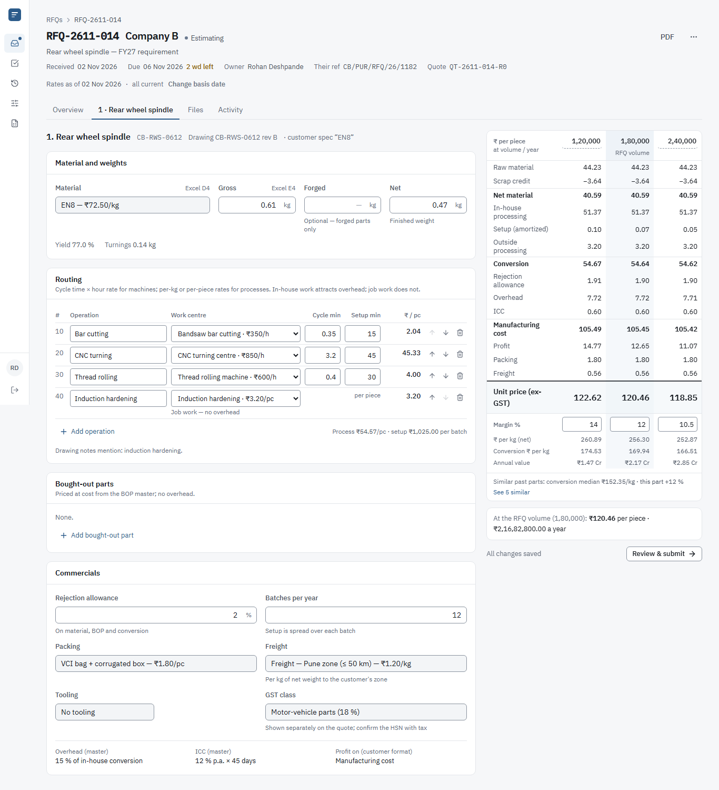
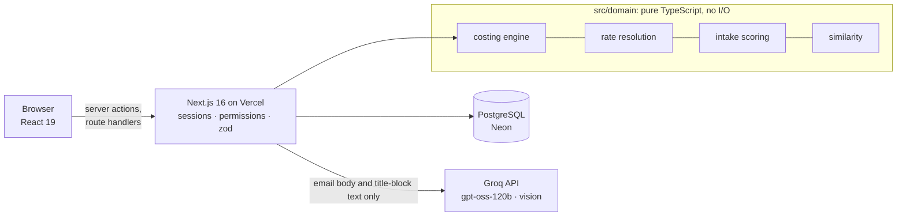

# Quote Desk

RFQ-to-quote costing for **Company A**, a machined and forged auto-component maker in Chakan, Pune
(assignment brief #1). Estimators turn a customer's RFQ email, part list and drawings into a
costed quote at several annual volumes, priced from dated rate masters; quotes above ₹25 lakh of
annual value go to the sales head for approval; the customer receives a PDF.



- **Live demo:** _added when deployed_ · sign in as the estimator `rohan.deshpande@companya.example`
  or the sales head `vikram.joshi@companya.example`, password `Chakan@2026`
- **Run locally / deployment / environment variables:** [docs/deployment.md](docs/deployment.md)
- **Design notes** (formulas, worked examples, every assumption labelled A-1…A-27):
  [docs/DESIGN.md](docs/DESIGN.md) · **Intake accuracy:** [docs/intake-eval.md](docs/intake-eval.md) ·
  **Sample data:** [sample-data/README.md](sample-data/README.md)

## What it does

| | |
|---|---|
| **RFQ register** | Every RFQ with owner, working days to due, status and annual value; views for "mine", awaiting approval, ready to send; overdue and returned chips; turnaround, win rate and estimator time for the sales head. |
| **Intake (AI)** | Drop the RFQ email (attachments come with it) or a part list and drawings. Values are read with evidence and a line number, scored High / Medium / Low by deterministic rules, conflicts between sources shown as explicit choices. Nothing reaches the RFQ until the estimator accepts it. Rule-based fallback when the AI is unavailable or the customer's NDA forbids it. |
| **Part costing** | Material and weights, routing (machine hours, per-kg and per-piece processes, in-house vs job work), bought-out parts, rejection, overhead, ICC, profit, packing, freight and tooling, at up to three volumes with a margin ladder. Exact decimal maths, recalculated as you type, autosaved. |
| **Rate masters** | One master for every rate, each change a new dated version; view the master as of any date; back-dating and voiding refused when they would change a submitted quote. |
| **Approval and quote** | Submitting freezes the costing with the exact rate versions (hashed snapshot). Above ₹25,00,000 of annual value the sales head approves or returns it; then sends it (mock email) with a stored PDF. |
| **Past quotes** | The 1,400-row legacy Excel register imported with a row-by-row report; similar past parts ranked with the reasons shown; routings offered as a starting point; past prices brought to today's steel price. |

Two roles: **estimator** (intake, costing, submit) and **sales head** (approve, send, rate masters).
Every screen works on a phone; the costing screen is built for a 1366 px laptop first.

## How it is built



- **Next.js 16 (App Router), React 19, TypeScript, Tailwind 4** — one deployable for UI and API;
  server components read through services, mutations go through `defineAction` (session,
  permission and zod validation on every call; a test fails if any server action skips it).
- **PostgreSQL with Prisma 7** — relational data with real constraints: append-only audit log and
  snapshots enforced by triggers, immutable rate versions, a partial unique index for live versions,
  an atomic RFQ counter, `pg_trgm` search.
- **The domain is plain TypeScript** (`src/domain`): costing engine, rate resolution, approval
  rule, intake normalisation and confidence, similarity. Unit- and property-tested, used identically
  in the browser (live recalculation) and on the server (the number that is stored).
- **AI only reads documents.** The model transcribes values with verbatim evidence into a strict
  JSON schema; grounding, confidence, conflicts and every calculation are deterministic code.

## Tests

```bash
npm test            # ~260 unit + integration tests (Vitest; integration on real Postgres)
npm run test:e2e    # Playwright: submit → approve → send → PDF text; 360 px overflow on every screen
npm run eval:intake # extraction accuracy on 12 synthetic emails
```

Golden fixtures pin the three sample parts to the paisa at three volumes; property tests check
that printed lines always add up and that per-piece setup never rises with volume; integration
tests check that a new rate never changes a frozen quote. CI runs all of it on every push.

## Repository map

```
src/domain/        costing engine, rates, intake scoring, similarity — pure, tested
src/server/        services (one per area), auth, AI client, PDF, seed
src/app/           pages, server actions and API routes (Next.js App Router)
src/components/    UI kit and feature components
prisma/            schema, migrations (with triggers), seed entry point
sample-data/       generated legacy register and RFQ packs
scripts/           sample-data generator, intake eval, screenshots
tests/             integration, end-to-end and fixtures
```
