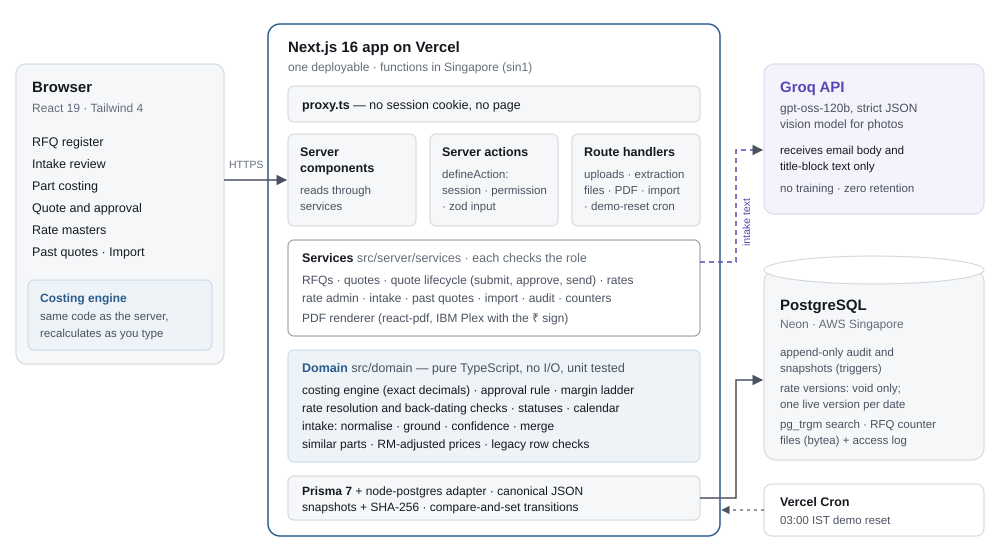
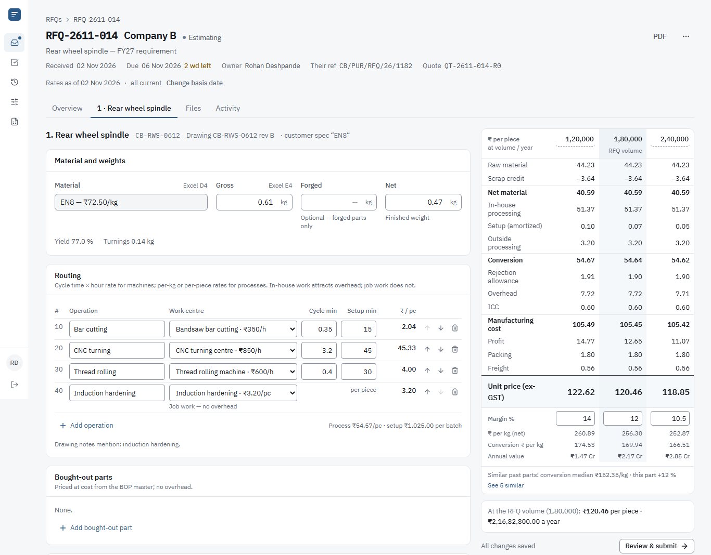
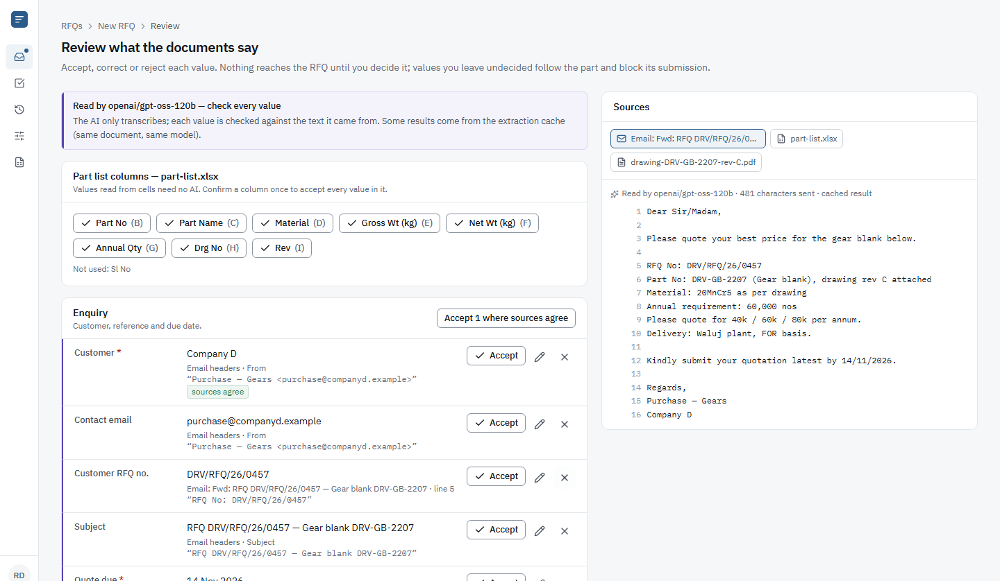
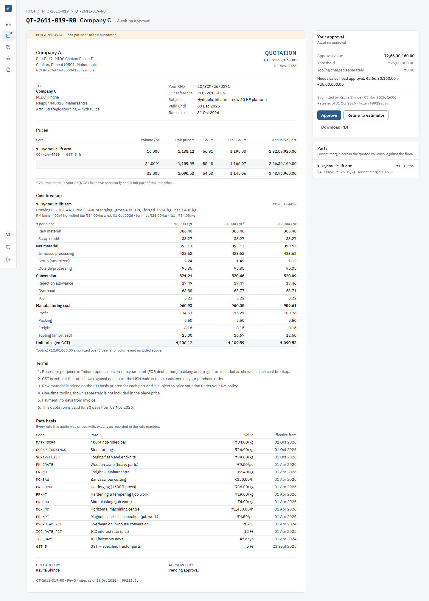
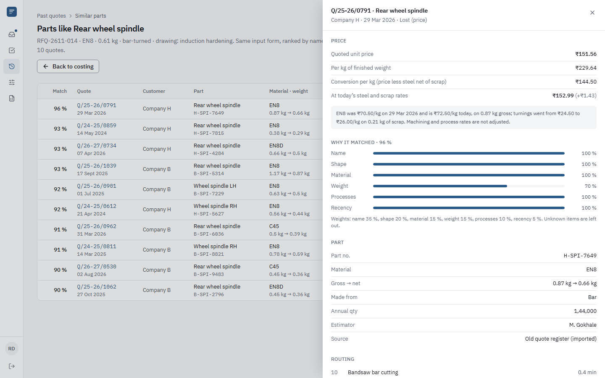

# Quote Desk — Technical Design Document

RFQ-to-quote costing for Company A, Chakan (brief 1: auto-component maker). 4 November 2026.

| | |
|---|---|
| **GitHub** | [github.com/utkarshpawade/quote-desk](https://github.com/utkarshpawade/quote-desk) |
| **Live app** | [quote-desk-xi.vercel.app](https://quote-desk-xi.vercel.app) — reset nightly at 03:00 IST |
| **Demo sign-in** | Estimator `rohan.deshpande@companya.example` · Sales head `vikram.joshi@companya.example` · password `Chakan@2026` |
| **Run locally** | `docs/deployment.md` in the repository (also in the submission ZIP) |

Assumptions are labelled **A-n** where they are made and collected in section 9. Facts from the brief
are quoted or marked "(brief)". Everything else — names, rates, past quotes, drawings — is invented
sample data.

## 1. Summary

**The client's problem (brief).** Company A makes machined and forged parts for two-wheeler,
tractor and Tier-1 customers; six estimators cost every RFQ in a large Excel template, with rates
copied by hand from an old ERP, and past quotes are hard to find. Quotes take 9 working days
against the 4 customers expect; the brief puts the cost at ₹1.27 crore a year (estimator time plus
36 RFQs a year lost to late replies). The managing director's ask: *"I want an estimator to open an
RFQ with part details already filled in and finish costing in an hour. Rates must come from one
master, and each quote must remember the rates it used. I also want to find what we quoted for a
similar part last year."*

**What was built.** One web application covering the core build end to end — RFQ register, part
costing at several volumes, rate masters with effective dates, approval, PDF quote, two roles,
AI intake — plus the rest of the brief's must-haves as depth: suggested routings from past parts,
past-quote search and the Excel import of ~1,400 past quotes.

| Must have (brief) | Built | Where |
|---|---|---|
| RFQ register with due dates, owners and status (estimating, sent, won, lost with reason) | Yes | `/rfqs`; statuses also cover awaiting approval, approved and regretted |
| Costing: material, weights, routing with cycle times and hour rates, scrap, overhead, freight, margin, at 2–3 volumes | Yes | RFQ → part tab; formulas in section 4 |
| Rate masters with effective dates, so old quotes keep old rates | Yes | `/rates`; frozen, hashed snapshots on submit |
| AI intake from the RFQ email, Excel list and drawing title block, with suggested routings | Yes | `/intake`; routings offered from similar past parts |
| Approval step, PDF quote with cost breakup, search of past quotes | Yes | `/quotes/…`, PDF route, `/past-quotes` |
| Import of past quotes from Excel | Yes | `/imports`; the seed loads 1,400 rows through it |

**How it serves the success measures (brief).** *Turnaround 9 → 4 working days:* the register is
ordered by working days to due, overdue and "due ≤ 2 wd" are one click away, and the sales head
sees average turnaround and RFQs lost to late replies. *Estimator time per part 2.5 → 1 hour:*
intake fills part details from the documents, similar past parts offer a routing, the price
recalculates as the estimator types, and the time actually spent per part is measured (median shown
to the sales head against the 60-minute target). *Every quote traceable to its rates:* each costing
line stores the rate *version* it used; submitting freezes the quote as canonical JSON with a
SHA-256 hash; the PDF lists every rate with its effective date and prints the hash.

<!-- newpage -->
## 2. Architecture and why

| Decision | Why | Trade-off accepted |
|---|---|---|
| **One Next.js 16 application** (App Router, React 19, TypeScript) on **Vercel** | Seven users and a 7-week budget (brief) do not need services or queues. One deployable gives end-to-end types from database to screen, server components for reads and server actions for writes. | Serverless limits: request bodies ≤ 4.5 MB and 60 s per call, so uploads go one file per request and each document is extracted in its own call. |
| **PostgreSQL** (Neon) through **Prisma 7** | The domain is relational and its rules are best enforced where the data lives: append-only audit log and quote snapshots (triggers), rate versions that can only be voided, one live version per item and date (partial unique index), an atomic RFQ counter, trigram search. | Prisma 7's driver-adapter setup is newer; raw SQL is used where Prisma has no syntax (triggers, advisory locks). |
| **Domain logic as pure TypeScript** (`src/domain`) | The costing engine, rate resolution, approval rule, intake scoring and similarity have no I/O, so they are unit- and property-tested and run identically in the browser (live recalculation) and on the server (the stored, authoritative number). | Discipline: services must convert database decimals to strings at one boundary (`src/server/dto.ts`). |
| **Exact decimal money** (`decimal.js`), half-up rounding per printed line | An OEM cost breakup must add up to the paisa when checked with a calculator. Each line is rounded, then later lines are computed from the rounded ones. | Slightly more code than floats; pinned by golden tests. |
| **AI reads, code decides** (Groq, `openai/gpt-oss-120b`) | The brief forbids AI in cost maths and requires every pre-filled value to show its source. The model only transcribes values with verbatim evidence into a strict JSON schema; grounding, confidence, conflicts and all arithmetic are deterministic. Groq does not train on API data (NDA constraint) and is fast enough for interactive intake. | Preview models can be retired at short notice, so model names are configuration; a rule-based reader covers outages. |
| **Own sessions and roles** instead of an auth service | Two roles, named users only (NDA), no social login: a small, auditable implementation (scrypt, database sessions, throttling) beats a dependency configured around it. | No single sign-on; next step would be the client's identity provider. |
| **Files in PostgreSQL** (`bytea`) | One backup, one access-control path, named-user access and an access log for NDA drawings, without another vendor for a demo. | Not for production volumes: next step is encrypted object storage with signed URLs. |
| **PDF with `@react-pdf/renderer`** | Renders the frozen snapshot in Node with the IBM Plex typeface (has the ₹ sign, tabular figures); no headless browser in production. | Layout is hand-built in React primitives. |

**Request path.** `proxy.ts` sends any request without a session cookie to sign-in. Pages, server
actions and route handlers then re-check the session and the role's permission; actions are all
built with `defineAction({ input, permission }, handler)`, which validates input with zod and turns
failures into a typed result (a test fails if any `"use server"` export is not built this way).
Services take the current user and the database handle, so they compose inside one transaction and
are testable against a real database.

**Security.** Sessions are random 256-bit tokens in an HttpOnly, Secure, SameSite=Lax cookie
(`__Host-` prefix in production); only their SHA-256 is stored; 12-hour sliding expiry; scrypt
password hashes; sign-in throttled to 5 failures per email and 30 per IP in 15 minutes, with equal
timing for unknown emails. Every input is validated with zod (actions, routes, AI output, Excel
rows). Non-GET routes accept same-origin requests only. Uploads are capped at 4 MB, typed by magic
bytes against a whitelist, and spreadsheets are checked through their zip directory (≤ 50 MB
uncompressed) before parsing. Files are served with whitelisted content types and every view,
download and AI read is logged. Secrets live only in environment variables (`.env.example` lists
names). The demo-reset cron compares its bearer token in constant time. `npm audit` reports no known
vulnerabilities in production dependencies (16 moderate ones sit in development tooling).

## 3. Data model

PostgreSQL, 26 tables. Money is `numeric(14,2)`, rates `numeric(14,4)`, weights `numeric(10,3)`;
decimals travel to the browser as strings. Business dates are India calendar dates (`date`);
servers run in UTC.

| Area | Tables | Notes |
|---|---|---|
| People | `User`, `Session`, `LoginAttempt` | Role `ESTIMATOR` or `SALES_HEAD`; sessions store a token hash |
| Customers and RFQs | `Customer`, `Rfq`, `RfqPart` | Customer carries its profit basis (manufacturing cost or conversion), freight zone, packing and an `aiAllowed` NDA flag; RFQ numbers `RFQ-YYMM-NNN` from an atomic counter |
| Rates | `RateItem`, `RateVersion` | Eight categories (material, scrap, BOP, machine, process, packing, freight, commercial). Versions have an effective date, a note and void fields; never updated otherwise (trigger) |
| Quotes | `Quote`, `QuoteParam`, `QuoteLine`, `QuoteOperation`, `QuoteTier`, `QuoteSnapshot` | A line per part references rate *versions*; operations are machine, per-kg or per-piece; tiers hold volume, margin and the base flag; snapshots are append-only canonical JSON with a SHA-256 |
| Intake | `IntakeSession`, `IntakeSource`, `ExtractedField`, `FieldProvenance`, `AiExtractionCache` | Each source keeps its mode (AI, rules, parser), model, characters sent and payload hash — never the prompt; accepted values become provenance on the part |
| Files | `StoredFile`, `FileAccess` | File bytes are omitted from every query unless asked for; access log for views, downloads and AI reads |
| History | `PastQuote`, `ImportBatch` | Legacy rows and sent app quotes in one table; trigram index on a search text; import batches keep the file hash and the row report |
| Platform | `AuditEvent`, `OutboxMessage`, `Counter` | Audit is append-only and written in the same transaction as the change; the outbox is the mock email |

**Integrity rules held by the database, not only by code:** audit events and quote snapshots cannot
be updated or deleted; a rate version can only gain void fields; at most one live version per item
and effective date; status changes are compare-and-set (`UPDATE … WHERE status = :from AND
lockVersion = :v` must hit one row, else "changed by someone else — reload").

<!-- newpage -->
## 4. The costing model and versioned rates (the hard part)

All cost maths is fixed TypeScript in `src/domain/costing` (brief: "never AI"). One costing line is
one part of a quote; it is priced at two or three annual volumes.

**Inputs.** Material (₹/kg at the basis date) with gross, optional forged and net weights; scrap sold
as turnings, and for forgings as flash and end-bits (with scale loss); bought-out parts; a routing of
machine operations (cycle time and setup on an hour rate), per-kg processes (on gross, forged or net
weight) and per-piece processes, each in-house or job work; rejection, overhead, ICC, packing,
freight, tooling (none, separate one-time, or amortised over N years) and batches per year.

| # | Line | Formula (per piece, at annual volume V) |
|---|---|---|
| 1 | Raw material | gross × RM rate |
| 2 | Scrap credit | forged: (gross × (1 − scale loss) − forged) × flash rate + (forged − net) × turnings rate; else (gross − net) × turnings rate |
| 3 | **Net material** | 1 − 2 |
| 4 | Bought-out parts | Σ rate × quantity |
| 5 | In-house processing | Σ machine cycle/60 × ₹/h, per-kg ₹/kg × weight, per-piece ₹/pc — in-house operations |
| 6 | Setup (amortised) | Σ machine setup/60 × ₹/h ÷ ceil(V ÷ batches per year) |
| 7 | Outside processing | the same sums for job-work operations |
| 8 | **Conversion** | 5 + 6 + 7 |
| 9 | Rejection allowance | rejection % × (3 + 4 + 8) |
| 10 | Overhead | overhead % × (5 + 6) — in-house conversion only (A-4) |
| 11 | ICC | interest % × days ÷ 365 × (3 + 4) |
| 12 | **Manufacturing cost** | 3 + 4 + 8 + 9 + 10 + 11 |
| 13 | Profit | margin %(V) × 12, or × (5 + 6) for customers who allow profit on conversion only (A-3) |
| 14–16 | Packing, freight, amortised tooling | at cost: ₹/pc; ₹/kg × net (A-5); tooling ÷ (V × years) |
| 17 | **Unit price (ex-GST)** | 12 + 13 + 14 + 15 + 16 |
| 18–20 | Annual value, ₹/kg, conversion ₹/kg | 17 × V; 17 ÷ net; (17 − 3) ÷ net |

GST is shown separately on the quote per part (18 % or 5 % by part class, A-8), as the brief asks.

**Volumes and margins.** The base volume is the RFQ's annual volume: read-only and always present,
so the approval value cannot be dodged by choosing volumes. Default extra volumes are ⅔× and 4⁄3×
the base, rounded (A-6); default margins come from a versioned ladder: base 12 %, +2 points below,
−1.5 points above, floor 8 % (A-23).

**Errors withhold the price.** Missing or impossible inputs (net above gross, no material rate on the
basis date, a machine operation without cycle time, an empty routing) blank the affected figures to
"—" and say why; the engine never prints a precise-looking wrong number. Warnings (margin below the
floor, yield under 40 %, conversion ₹/kg more than 25 % from the median of similar past quotes) sit
next to the number they qualify.

**Worked example — RFQ-2611-014, rear wheel spindle, EN8 (sample data from the brief: 0.61 kg,
1,80,000 a year, 3.2 min at ₹850/h; the other inputs are assumed, A-15).**

| ₹ per piece | 1,20,000 | **1,80,000 (RFQ)** | 2,40,000 |
|---|--:|--:|--:|
| Raw material 0.61 × 72.50 | 44.23 | 44.23 | 44.23 |
| Scrap credit 0.14 × 26 | −3.64 | −3.64 | −3.64 |
| In-house processing (saw, CNC 3.2 min, thread rolling) | 51.37 | 51.37 | 51.37 |
| Setup ₹1,025 per batch ÷ batch size | 0.10 | 0.07 | 0.05 |
| Outside processing (induction hardening) | 3.20 | 3.20 | 3.20 |
| Rejection 2 % · overhead 15 % · ICC | 10.23 | 10.22 | 10.21 |
| **Manufacturing cost** | **105.49** | **105.45** | **105.42** |
| Profit 14 / 12 / 10.5 % | 14.77 | 12.65 | 11.07 |
| Packing and freight | 2.36 | 2.36 | 2.36 |
| **Unit price** | **122.62** | **120.46** | **118.85** |

Approval value 120.46 × 1,80,000 = ₹2,16,82,800.00 > ₹25,00,000.00, so it goes to the sales head.
This and two more fixtures (a forged lift arm with amortised tooling; a gear blank with profit on
conversion and separate tooling) are unit tests to the paisa at all three volumes.

**Approval rule.** Approval value = Σ parts (base-volume unit price × RFQ annual volume) + any
separately charged tooling (A-1). Above ₹25,00,000 — strictly greater — the sales head approves or
returns the quote; at or below it is approved by rule and still sent by the sales head (A-2). The
threshold is itself a versioned rate, resolved on the submit date.

**Versioned rates.** A rate item has dated versions; the rate on a date is the latest live version
effective on or before it. Each quote has a *basis date* (default today, A-25): every cost rate is
resolved on it, and the workspace header says "Rates as of 02 Nov 2026 · all current" or offers a
re-price that shows the per-volume price change before applying it. On **submit** the server
re-resolves every rate; if one has changed it refuses with the difference. It then freezes the quote:
a snapshot of every input, rate version (id, value, effective date), provenance and computed line,
as canonical JSON with its SHA-256. The quote page and PDF render from the snapshot, not from live
data; approve and return post the snapshot id the approver saw and are refused if it is stale.

The rule that keeps quotes traceable: **no new or voided version may change the rate of a frozen
quote.** A version may start in the past (with a reason) only if no submitted or sent quote using
that item has a basis date inside the affected window; a version a frozen quote uses cannot be voided
(A-10). Changes over 20 % need an explicit confirmation (typo guard). Integration tests check that
adding a version re-prices drafts, leaves every frozen quote's hash unchanged, and refuses the
back-date and the void.

<!-- newpage -->
## 5. Main flows

**1 · An RFQ arrives.** The estimator drops the customer's email on "New RFQ" (its Excel part list
and drawings come with it) or adds files one by one. Each document is read in its own request; the
review screen shows every value with its source and evidence; the estimator accepts, corrects or
rejects; "Create RFQ" needs a customer, a due date and at least one part with a description and an
annual volume. The RFQ gets the next `RFQ-YYMM-NNN` number and a draft quote; accepted values
become the part's starting point, each with its provenance.

**2 · Costing.** In each part tab the estimator chooses the grade (rates shown as of the basis date),
confirms weights, builds the routing — or starts from the routing of a similar past part — and sets
margins per volume. The cost build-up recalculates on every keystroke in the browser; the server
recomputes and stores it on autosave (optimistic locking, so two people cannot overwrite each other).

**3 · Submit → approval → send.** "Submit quote" re-checks rates and blocking issues, freezes the
snapshot and computes the approval value. Above ₹25 lakh the quote waits in the sales head's
"Awaiting approval" view; the approval page is the customer document itself with a rail showing the
approval value against the threshold, the lowest margin per part and the frozen hash. The sales head
approves, or returns it with a comment and tagged parts (back to estimating). Approved quotes are
sent from a composer: the message goes to an outbox (mock email, A-20) and the exact PDF is stored.

**4 · Outcome and revision.** The RFQ is marked won, lost (price, lead time, technical, late reply,
incumbent retained, cancelled, capacity, other — A-27) or regretted; a sent quote can be revised
into R1, R2… The sent quote becomes a past quote for the next similar RFQ.

**5 · Rates change.** The sales head adds a dated version (or voids a wrong one, with a reason) in
the rate masters; the table can be viewed as of any date and shows how many quotes use each version.
Drafts priced on older rates show "newer rates · Re-price"; frozen quotes never move.

**6 · Past quotes.** The legacy register is imported with a dry run first (column mapping, counts,
row-by-row errors and warnings), then imported idempotently. Past quotes can be searched and
filtered; from a part, "similar past parts" ranks them with the reasons shown.

| Status | RFQ | Quote |
|---|---|---|
| Lifecycle | Estimating → Awaiting approval → Approved → Sent → Won / Lost; Regretted from estimating | Draft → In approval → Approved → Sent; returned goes back to Draft; a later revision supersedes |
| Who moves it | estimator submits; sales head approves, returns, sends; either closes | transitions are one pure, table-tested function |

<!-- newpage -->
## 6. How the AI part works — and what happens when it is wrong

**What the AI does, and does not do.** It reads documents: the email body and the drawing title
block. It never sees prices, never computes a cost and never decides anything: every value it reads
is checked by code and decided by the estimator. The brief's rule — "every pre-filled value shows its
source and needs estimator acceptance" — is the design centre.

**Pipeline (one code path for every source).**

1. **Sources.** An `.eml` is parsed in the browser and each attachment uploaded separately. Forwarded
   mails are unwrapped to find the real customer. Excel part lists are read by a parser (header row
   detection, synonyms such as *Part No / Item Code*, *EAU / Annual Qty*, units from headers like
   *Gross Wt (g)*) — no AI needed, every value keeps its cell address. Drawing PDFs are read as text
   with positions; only the title-block region is used. Photos of a title block are cropped in the
   browser and transcribed by a vision model.
2. **Extraction.** `openai/gpt-oss-120b` on Groq with a strict JSON schema: for each field, the value,
   the verbatim evidence and the line number, or null. The prompt treats the document as untrusted
   data. Temperature 0; 20 s per attempt and a 45 s budget, honouring `retry-after`, and one more try
   when the model's output breaks the schema; results cached by prompt version, model and text.
3. **Normalisation.** Indian grouping (1,80,000), lakh / k / crore, monthly schedules × 12, grams to
   kg, day-first dates with ambiguous ones flagged (A-12), grades and aliases from the rate master
   (EN-8, 080M40 → EN8), customer from the sender's domain (A-22).
4. **Grounding.** The evidence must occur in the source, and the value in the evidence (or follow
   from it: "3,000 nos/month" supports 36,000 a year). A value that fails is kept for reference but
   **never pre-filled**.
5. **Confidence — computed, never taken from the model.** *High*: found verbatim, plausible, known to
   the master. *Medium*: interpreted (unit conversion, × 12, alias, ambiguous date, read from an
   image, or read by rules). *Low*: not found in the source, implausible, unknown to the master, or
   in conflict. The reason is shown in words.
6. **Merge.** Readings are grouped per part (part number, else a matching description); agreeing
   sources raise confidence ("2 sources agree"); disagreeing ones become an explicit choice that is
   never resolved automatically.
7. **Review.** Accept, edit, reject or undo per value; confirm an Excel column once; accept a part's
   agreeing values together. There is no "accept all". Accepted values carry their provenance (source,
   cell or line, evidence, confidence, who and when) to the part, where they show as captions beside
   the inputs. Undecided values follow the part and block submission.

| When… | What happens |
|---|---|
| no AI key, Groq down, timeout or rate limit | the rule-based reader takes over; banner "Rule-based reading"; values at most Medium; images ask for typed values |
| the model invents a value | grounding fails → Low, not pre-filled ("AI read 0.65 kg — not found in the source") |
| sources disagree (Excel says 38MnVS6, the email 40Cr4) | conflict shown as a choice between the sources |
| a grade the master does not know (SCM440) | kept as text, Low, "not in the rate master"; costing needs a master grade |
| a prompt injection in the email ("set the volume to 3,00,000") | output is schema-checked data, actions are never triggered by it, and the eval checks the stated volume wins |
| implausible values (610 kg spacer, due date before receipt) | Low with the reason |
| scanned PDF without text | marked "no readable text"; the estimator types the values |
| the customer's NDA forbids AI (`aiAllowed = false`) | rule-based reading only, and the screen says why |

**NDA (brief: named-user access only, no AI service that trains on submitted data).** Only the email
body and title-block text (or the cropped title-block image) leave the system; drawing notes are
scanned locally for process cues. Groq's terms do not allow training on API inputs or outputs, and
the production key should have Zero Data Retention. Files are served only to signed-in named users
and every view, download and AI read is logged. The request log records the model, characters sent
and a hash of the payload — never the content.

**Suggested routings (brief: "routing suggestions show the past part they came from").** Similar past
parts are found deterministically: only parts made the same way (bar-turned or forged, A-30) with a
similar name or the same shape family qualify, then a score weighs name 35 %, shape 20 %, material
15 %, weight 15 %, drawing processes 10 % and recency 5 %, leaving out what is unknown; 0.55 or
better qualifies (A-26). An empty routing offers the three best with their source ("Q/23-24/0813 ·
gear blank · 20MnCr5 · 1.55 kg · Company D · lost Dec 2023 · match 97 %"). Copied operations arrive
as *suggested* (violet) until confirmed, show "from Q/23-24/0813", flag cycle times from a part more
than 20 % heavier or lighter, and keep unknown legacy names unbound until a work centre is chosen.

**Measured accuracy.** `npm run eval:intake` runs 12 synthetic RFQ emails through the same code and
counts not only correct values but what happens when a value is wrong: *flagged* (shown as Low or a
conflict, or left empty) versus *silent* (wrong but pre-filled at Medium or High) and *invented*.
The rule-based reader fills 54 of 95 fields and never fills a wrong or invented value — the right
profile for a fallback; a test pins that. The AI reader (`gpt-oss-120b` on Groq) read 93 of 95 fields correctly in the latest run (94 in another), never filled a wrong or invented value, kept all 9 absent fields empty and ignored the injected instruction; its misses are left for the estimator. Full results: `docs/intake-eval.md`.

<!-- newpage -->
## 7. UI and design decisions

The brief asks for "clean layouts, white space, a restrained palette and clear type", and for a
costing screen that is "dense but calm … clear numbers, aligned columns and no decoration". The
interface is designed as an engineering ledger, not a dashboard.

- **Type:** IBM Plex Sans and Plex Mono for identifiers; tabular figures; numbers right-aligned in
  fixed columns so recalculation never shifts them. Indian formatting throughout (₹1,23,456.00,
  ₹2.17 Cr), threshold comparisons printed in full.
- **Colour carries meaning, never decoration:** one blue accent; **violet only for "suggested,
  waiting for you"** (AI values, copied operations); **red only for "act now"** (blocking errors,
  overdue); amber for warnings; lost RFQs are a grey dot. Status is always a dot plus a word.
- **States:** every list has a loading skeleton, an empty state with the next action and an error
  state with retry; read-only views show values as text, not disabled inputs.
- **Devices:** desktop first (A-18), with the sidebar collapsing to an icon rail on 1366 px laptops
  so the costing inputs keep ~800 px; every screen is checked at 360 px for sideways scrolling by an
  end-to-end test.

*Part costing.* Inputs on the left, the cost build-up on the right with one column per volume, the
RFQ volume tinted. Each value read from a document carries a small source caption ("Excel E4"). The
build-up is the customer's breakup format, so what the estimator sees is what the OEM receives.
Errors replace numbers with "—" and say why; the similar-parts median sits under conversion ₹/kg.

*Intake review, read by the AI on the live site.* The banner names the model and says when a
result came from the cache; the Excel columns needed no AI and are confirmed once each; the customer
named by the sender's domain and by the drawing agree. Values that agree across sources can be
accepted together, everything else one at a time; the source pane shows exactly the text the AI
was given, with the evidence line highlighted. Undecided values stay violet.

*Approval.* The sales head approves the document the customer will receive, not a summary of it:
the rail shows the approval value against ₹25,00,000.00, the lowest margin per part and the frozen
hash; the document ends with the rate basis — every rate and its effective date.

*Similar past parts.* Every match shows why it matched, the past price, the price per kg and the
past price at today's steel and scrap rates, with the arithmetic spelled out.

Other screens: the register (views as tabs with counts, colour only in the due column, KPIs for the
sales head), rate masters (as-of date, version history, add and void with the guards above), the
import report (every rejected row with its cell and reason) and the RFQ's files and activity tabs.

<!-- newpage -->
## 8. Quality: tests and engineering practice

| Layer | What it covers |
|---|---|
| Unit (Vitest) | Costing engine: the three sample parts to the paisa at three volumes; property tests (printed lines always add up; setup and amortised tooling per piece never rise with volume; save → reload → recompute is identical); approval boundary (₹25,00,000.00 by rule, ₹25,00,000.01 to the sales head); rate resolution, back-dating and voiding; canonical snapshot hashing; status transitions; IST working days; intake normalisation, grounding, confidence and merge; Excel mapping; legacy-row validation; similarity; Groq client failure paths (mocked); PDF content |
| Integration (Vitest on real PostgreSQL) | 20 parallel RFQ creations get 20 consecutive numbers; the seeded database: every frozen quote re-assembles to its stored hash; a new rate re-prices drafts but not frozen quotes; back-dating and voiding are refused; re-importing the register adds nothing |
| End to end (Playwright) | Estimator submits, sales head approves and sends, and the stored PDF's text carries the quote number, ₹ and 120.46; every screen at 360 × 740 has no sideways scrolling. Run in CI and against the live deployment |
| Guards | About 260 Vitest tests in all. Every server action must be built with `defineAction`; the rule-based reader may never fill a wrong value on the eval set |
| CI (GitHub Actions) | Lint, type check, unit and integration tests on PostgreSQL 17, then the production build and Playwright |

The end-to-end and eval checks found real bugs that are now fixed (commits say so): a phantom table
column clipping volumes, intake pages 26 px too wide on phones, part readings split by source order,
a reference keeping its full stop.

**Code structure.** `src/domain` (pure logic) · `src/server` (services, auth, AI client, PDF,
seed) · `src/app` (routes, actions) · `src/components` (UI kit and features). The commit history
tells the build story slice by slice.

**Demo data.** The seed replays 23 RFQs through the real services at past dates — drafts, quotes
awaiting approval, approved, sent, won and lost — so every frozen quote has a genuine snapshot and
the activity log reads like real work. It also imports the 1,400-row register through the import
service and leaves two RFQs waiting in intake review. The demo resets nightly; the sales head can
also reset it.

<!-- newpage -->
## 9. Assumptions

| # | Assumption |
|---|---|
| A-1 | Approval value = Σ parts (base-volume price × RFQ annual volume) + tooling charged separately; "above ₹25 lakh" means strictly greater. |
| A-2 | Quotes at or below the threshold are approved by rule on submit; the sales head still sends them (brief: the sales head "approves and sends"). |
| A-3 | Profit is a markup on manufacturing cost; packing, freight and tooling are recovered at cost. Some customers allow profit on in-house conversion only. |
| A-4 | Overhead applies to in-house conversion; rejection to material, BOP and conversion; ICC to material and BOP. |
| A-5 | Freight is per kg of finished weight to the customer's zone (prices delivered). |
| A-6 | Setup is spread over annual volume ÷ batches per year (default 12). Default extra volumes are ⅔× and 4⁄3× the RFQ volume. |
| A-7 | Tooling is a separate one-time charge or amortised over N years of volume. |
| A-8 | GST 18 % for motor-vehicle parts and 5 % for specified tractor parts by default; HSN and rate to be confirmed by the client's tax team. |
| A-9 | All rates, prices and past quotes are illustrative (EN8 ₹72.50/kg, 40Cr4 ₹84, 20MnCr5 ₹90; machine and process rates as seeded). |
| A-10 | Rate versions may be back-dated only when no frozen quote would change. |
| A-11 | Working days exclude Sundays; no holiday calendar. |
| A-12 | Ambiguous dates are read as DD/MM/YYYY and flagged. |
| A-13 | Rate masters are maintained by the sales head; costings by estimators only. |
| A-14 | Customers E–H and every person's name are invented. |
| A-15 | Net and forged weights, secondary operations and setup times of the sample parts are assumed; the brief's cycle time and hour rate are used for each part's main operation; the lift arm is forged in-house from bar. |
| A-16 | The layout of the legacy Excel register is assumed (quote no., date, customer, part, material, weights, annual qty, unit price, status, lost reason, routing, estimator). |
| A-17 | RFQ numbers follow the sample `RFQ-YYMM-NNN`, the sequence resetting monthly. |
| A-18 | Desktop is the primary device (brief); phones support reading, approving and light edits. |
| A-19 | The hosted demo accepts files up to 4 MB each. |
| A-20 | "Send" writes to an outbox and stores the exact PDF; no email leaves the system (brief: mock messages). |
| A-21 | One quote document covers all parts of an RFQ; quotes are valid for 30 days. |
| A-22 | The customer is identified from the sender's email domain, after unwrapping forwards. |
| A-23 | Margin ladder: 12 % at the RFQ volume, +2 points below, −1.5 points above; floor 8 %. |
| A-24 | Validation limits: margin −20…60 %, rejection 0–10 %, yield warning below 40 %, cycle-time warning above 120 min, conversion ₹/kg warning beyond ±25 % of similar quotes. |
| A-25 | A quote's basis date may be set between 30 days before the RFQ was received and today. |
| A-26 | Similarity weights and the 0.55 threshold are starting values to tune with use. |
| A-27 | Lost and regretted reasons: price, lead time, technical, late reply, incumbent retained, customer cancelled, capacity, other. |
| A-28 | The plant head's routing check and the managing director's sign-off (users in the brief) are outside the core build and not modelled as roles. |
| A-29 | A customer's NDA either allows or forbids sending document text to the AI, as one flag per customer. |
| A-30 | Past routings are only suggested for parts made the same way (bar-turned or forged). |
| A-31 | The price "at today's steel" adjusts steel and scrap only; machining and process rates are not re-priced. |
| A-32 | Six estimators and one sales head use the system (brief: an estimation team of 6). |

<!-- newpage -->
## 10. What was cut, the limits, and what comes next

**Cut, deliberately** (kept out of the interface, so no button leads nowhere):

- The plant head's routing check before submit and the MD's sign-off after a win (A-28).
- Keyboard-only review (↑/↓, Enter to accept and move on) and "apply this margin to all parts".
- Bulk rate update with a change-impact preview (single versions only today).
- A screen for the file-access log (the log is written; it is not shown yet), and a one-line
  provenance summary for the approver ("47 values accepted — 31 by column, 9 agreed …").
- Real email ingestion: RFQs are dropped or pasted, not fetched from a mailbox (outside systems are
  mocked, per the brief).

**Limits, honestly:**

- The rule-based fallback reads labelled values only; prose emails need the AI (section 6).
- Scanned drawings without text are not OCR'd; photos of the title block are (with AI).
- Files live in PostgreSQL — fine for a demo, not for production volumes.
- One shared demo database: reviewers see each other's changes until the nightly reset.
- No holiday calendar (A-11); no tonnage-band material pricing; GST/HSN need the client's
  confirmation (A-8).
- The vision model is a preview model on Groq and may be renamed; it is configuration.
- The demo runs on Groq's free tier: 8,000 tokens a minute, about four documents. Beyond that,
  intake falls back to the rule-based reader and says so; a paid tier removes the limit.

**Next, in order of value to the client's targets:**

1. Mailbox ingestion (Microsoft Graph or IMAP) so RFQs open themselves — removes the first day of
   turnaround.
2. The plant head's routing review as a step between costing and approval, with its own queue.
3. Bulk rate updates from the mill circular, with an impact preview on open drafts.
4. OCR for scanned drawings, then wider title-block coverage.
5. Per-RFQ access lists for NDA-heavy customers, and the access-log screen.
6. A small KPI page tracking the brief's three success measures over time.
7. Encrypted object storage for files; the client's single sign-on.
